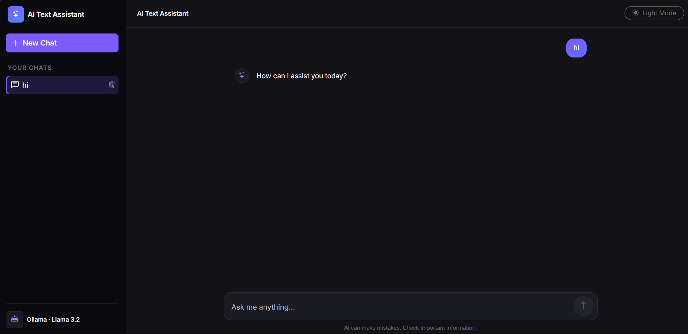
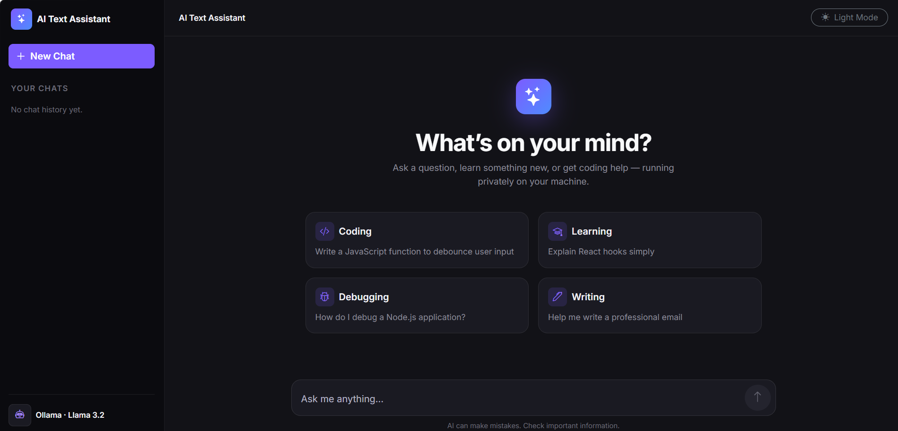
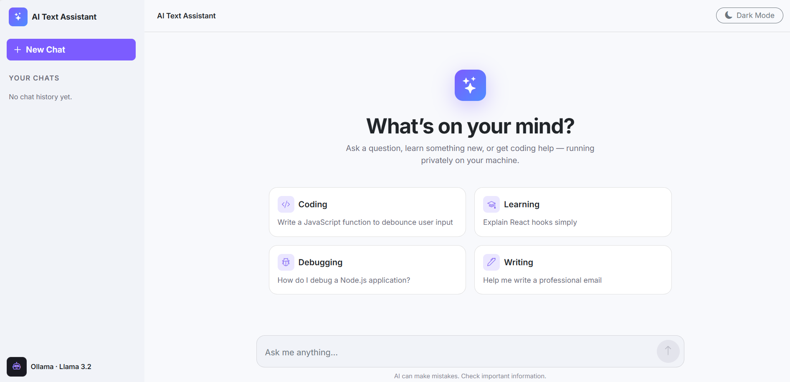

# AI Text Assistant

An AI-powered text assistant built using the MERN stack and Ollama. It uses the Llama 3.2 language model to generate AI responses locally without depending on paid AI APIs.

## Features

- **AI-Powered Responses:** Generate responses using the Llama 3.2 model through Ollama.
- **Chat History:** Save and access previous conversations.
- **Chat Management:** Create new chats and delete existing conversations.
- **Responsive UI:** Chat interface built with React.js and Bootstrap.
- **Dark and Light Mode:** Switch between themes.
- **Database Integration:** Store conversations in MongoDB.
- **Error Handling:** Display errors and loading indicators during AI requests.

## Tech Stack

**Frontend:** React.js, Bootstrap, Axios

**Backend:** Node.js, Express.js

**Database:** MongoDB, Mongoose

**AI Model:** Ollama, Llama 3.2 (3B)

**API:** REST API

## Project Structure

```text
AI-Text-Assistant/
├── client/
│   ├── src/
│   ├── public/
│   └── package.json
├── server/
│   ├── controllers/
│   ├── models/
│   ├── routes/
│   ├── package.json
│   └── .env
├── .gitignore
└── README.md
```

_Note: Adjust the folder structure if your actual project is different._

## Prerequisites

Before running the project, install:

- Node.js and npm
- MongoDB (local installation or MongoDB Atlas)
- Ollama

## Installation and Setup

### 1. Clone the Repository

```bash
git clone YOUR_GITHUB_REPOSITORY_URL
cd AI-Text-Assistant
```

Replace `YOUR_GITHUB_REPOSITORY_URL` with your actual GitHub repository URL.

### 2. Set Up the Backend

```bash
cd server
npm install
```

Create a `.env` file inside the `server` folder and configure your MongoDB connection string according to your backend code.

Example:

```env
MONGO_URI=your_mongodb_connection_string
PORT=5000
```

Use the exact environment variable names expected by your application. Never upload real credentials or API secrets to GitHub.

### 3. Set Up the Frontend

Open another terminal from the project root:

```bash
cd client
npm install
```

### 4. Install and Run Ollama

Install Ollama from https://ollama.com/

Pull the model:

```bash
ollama pull llama3.2:3b
```

Start the Ollama service if it is not already running.

The backend uses the local Ollama API at:

```text
http://localhost:11434
```

### 5. Run the Application

Start the backend:

```bash
cd server
npm run dev
```

If your project does not have a `dev` script, use the script defined in your `server/package.json`.

Start the frontend in a separate terminal:

```bash
cd client
npm run dev
```

Open the local URL displayed by Vite in your terminal.

## How It Works

1. The user enters a prompt in the React frontend.
2. The frontend sends a request to the Express backend.
3. The backend sends the prompt to the Llama 3.2 model through Ollama.
4. Ollama generates a response.
5. The backend saves the conversation in MongoDB.
6. The response is displayed in the chat interface.

## Screenshots





